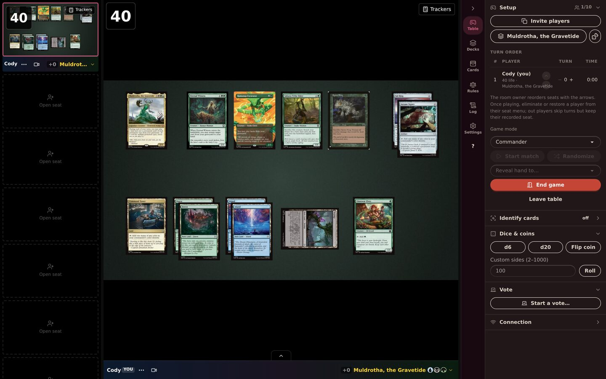
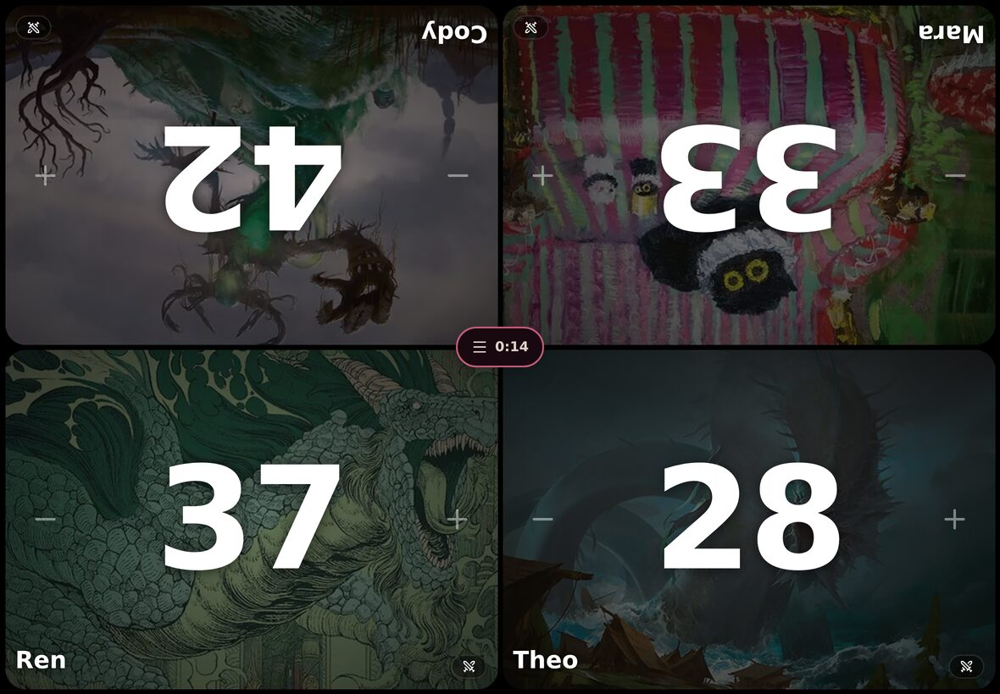
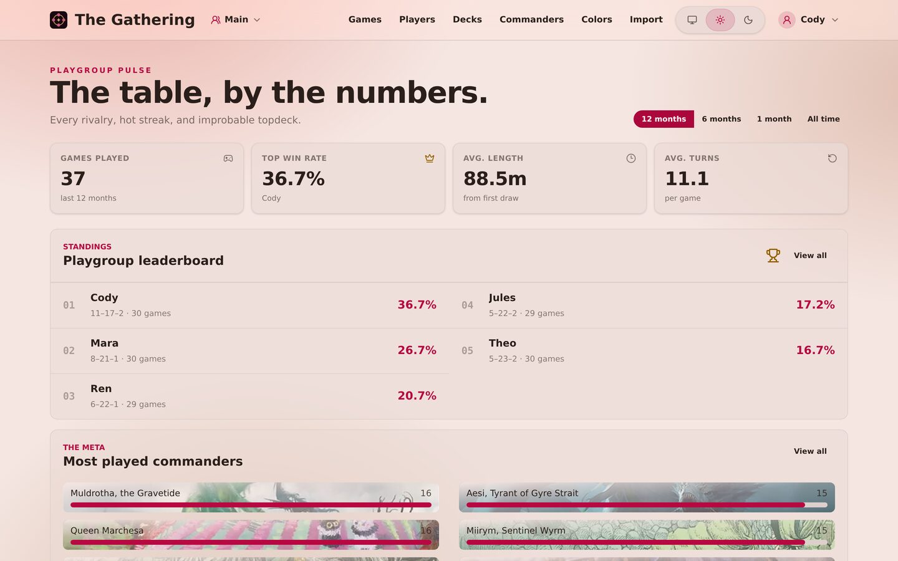
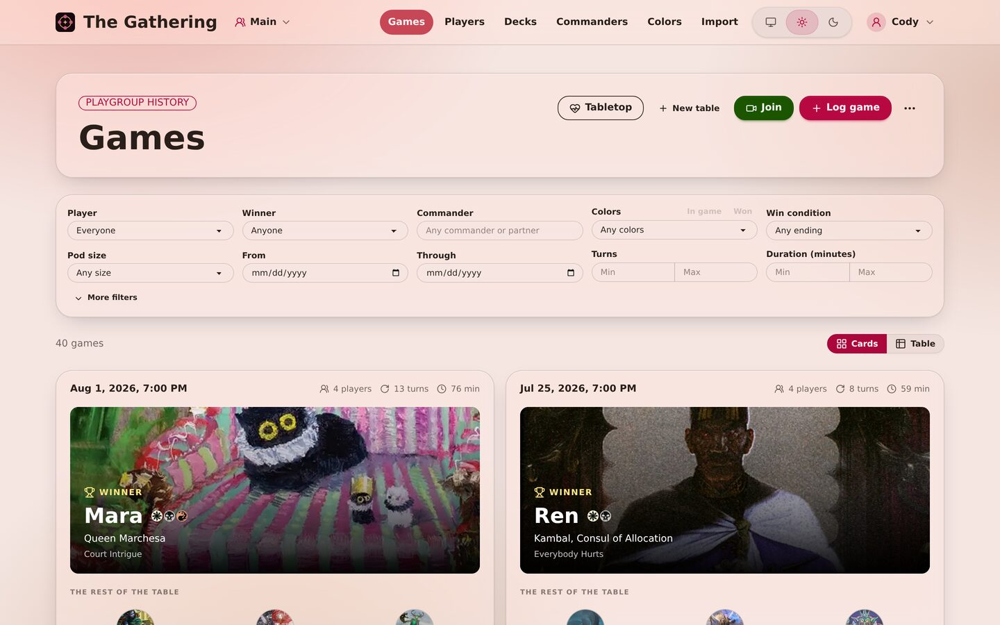
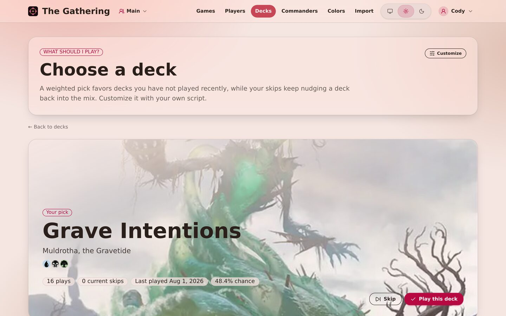

# The Gathering

A self-hosted Commander table for your playgroup: play over webcams or around one phone, and
every game lands in your group's history and stats.



## Play remotely

**Games → Play** opens a room for up to ten players. Point a camera at your board and everyone
sees everyone. Click any card on any board to identify it, with its rules text and rulings. The
room tracks life, commander damage, turns, and clocks. Supported modes are Commander,
Two-Headed Giant, Five Star, Pauper Commander, Duel Commander, and casual one-on-one formats.

Ask the **Rules** tab a question and an AI judge answers, citing the Comprehensive Rules and
each card's Oracle text.

## Play in person

**Games → Tabletop** turns one phone or tablet into the life counter for the whole table, with
each seat facing its player. Tap to change life, and hold to change it by ten. Commander damage,
poison, turns, and a game clock live in the middle.



## See who's winning

Every game, whether played at a table, logged by hand, imported, or reported from Discord,
feeds the stats: standings, Elo, seat advantage, matchups, colors, kill counts, and streaks.





## Decide what to play

The deck chooser favours decks you haven't played lately. Don't like the pick? Skip it, or write
your own weighting in Lua.



## Also included

- **Discord**: members sign in with Discord. `/newgame` posts a queue that opens a table once
  enough players join, and SpellBot games are tracked automatically.
- **Decks**: link Moxfield, Archidekt, or ManaVault lists, and pick the printing of each commander.
- **Playgroups**: one server hosts several groups, each with its own players, decks, and stats.
- **Imports**: bring history over from CSV, Mythic Track, or another The Gathering server.
- **Installable**: add it to a phone's home screen as an app.
- **Self-contained**: one container and one SQLite file. Card data syncs from Scryfall locally.

## Run your own

```sh
mkdir the-gathering && cd the-gathering
curl -fsSLO https://raw.githubusercontent.com/cfbender/the-gathering/main/docker-compose.yml
curl -fsSL https://raw.githubusercontent.com/cfbender/the-gathering/main/.env.example -o .env
sed -i.bak "s|^THE_GATHERING_SECRET_KEY=.*|THE_GATHERING_SECRET_KEY=$(openssl rand -base64 64 | tr -d '\n')|" .env
docker compose up -d
```

Open <http://localhost:4000> and create the administrator account.

**[Installation](docs/installation.md)** walks through a full setup in checkable steps: Docker,
Proxmox LXC, or a plain Linux service, plus Discord sign-in, HTTPS, webcam networking, backups,
updates, and every setting. It is written so that an agent given this repository can set up a
server end to end.

## Documentation

| | |
| --- | --- |
| [Installation](docs/installation.md) | Install, configure, update, back up, and troubleshoot a server. |
| [Features](docs/features.md) | How the webcam table, tabletop, game history, playgroups, deck links, and deck chooser behave. |
| [Administration](docs/administration.md) | Accounts and sign-in, audit history, live logs, and the card catalog. |
| [Discord integration](docs/discord-integration.md) | Bot setup, `/newgame` queues, and SpellBot tracking. |
| [Deck chooser scripts](docs/deck-chooser-scripts.md) | The Lua scripting reference and examples. |
| [CSV import](docs/csv-import.md), [Mythic Track import](docs/mythic-track-import.md) | Moving existing game history in. |
| [Personal API keys](docs/api.md), [Statistics](docs/stats.md) | Reading games and stats from scripts. |
| [Webcam table design](docs/webcam-table.md), [Data model](docs/data-model.md) | How the internals work. |

## Development

The backend is a Rust server in [`rust/`](rust/README.md) (axum + sqlx on SQLite, the shared
[lotus](https://github.com/cfbender/lotus) crate for Scryfall and deck-list sources). The
frontend is React in `assets/react`. The toolchain (Rust, SQLite, Node, aube) is pinned in
`mise.toml`. Install [mise](https://mise.jdx.dev), then:

```sh
mise run setup                # tools, JavaScript dependencies, server build, demo data
mise run dev                  # Rust server on $PORT (4000) + Vite on http://localhost:5173
```

Open the Vite port: it serves the React app with hot reload and proxies API, socket, and page
requests to the server. The server applies any missing migrations to `the_gathering_dev.db` at
startup and syncs the Scryfall catalog when it is empty.

In development (`THE_GATHERING_ENV=dev`, set by `mise run dev`) every request is signed in
automatically as the first administrator (a passwordless `dev` admin is created if none exists)
and sudo re-authentication is skipped. Run with `DEV_AUTO_LOGIN=false` to exercise the real
login flow; `/login` stays reachable either way.

Other commands:

```sh
mise run rust:check                    # schema check, cargo fmt --check, clippy -D warnings, cargo test
mise run test                          # Rust tests only
mise run precommit                     # Rust checks + frontend checks, tests, and build
mise exec -- aube exec vp check        # frontend fmt + lint + typecheck
mise exec -- aube run build            # production frontend bundle
mise run rust:new-migration add_thing  # new rust/migrations/<timestamp>_add_thing.sql
mise run rust:sqlx-prepare             # after a migration or a query change
```

The version lives in `rust/crates/the-gathering/Cargo.toml` and `package.json`. Releases are cut
with `mise run release -- major|minor|patch`, which updates [`CHANGELOG.md`](CHANGELOG.md) and tags
`vX.Y.Z` (see [`docs/releasing.md`](docs/releasing.md)). See [`AGENTS.md`](AGENTS.md) for conventions.

## License

[Mozilla Public License 2.0](LICENSE).
